# Домашнее задание к занятию «Helm» - Петр Петров

### Задание 1. Подготовить Helm-чарт для приложения

1. Необходимо упаковать приложение в чарт для деплоя в разные окружения. 
2. Каждый компонент приложения деплоится отдельным deployment’ом или statefulset’ом.
3. В переменных чарта измените образ приложения для изменения версии.

### Решение 1.

Проверка Helm-чарта

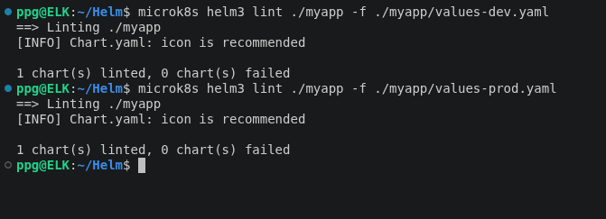

Генерация Development-манифестов

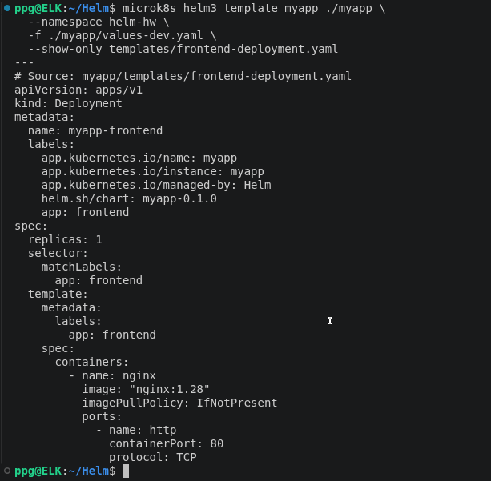

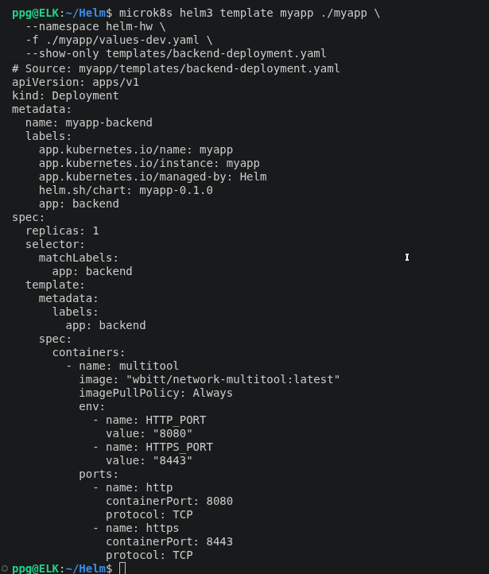

Генерация Production-манифестов

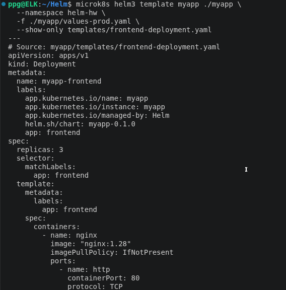

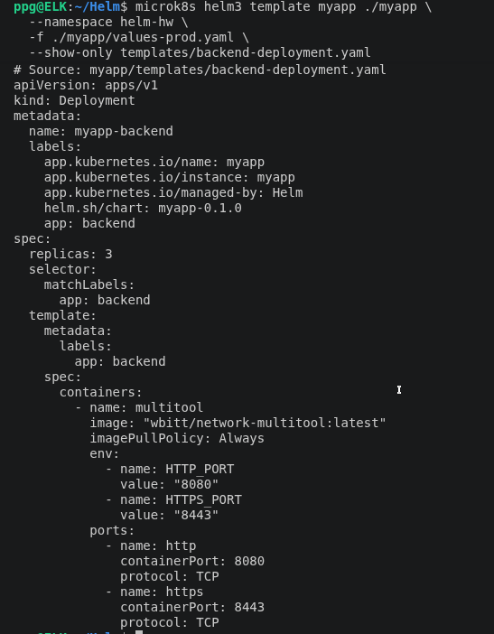

Kubernetes-ресурсы

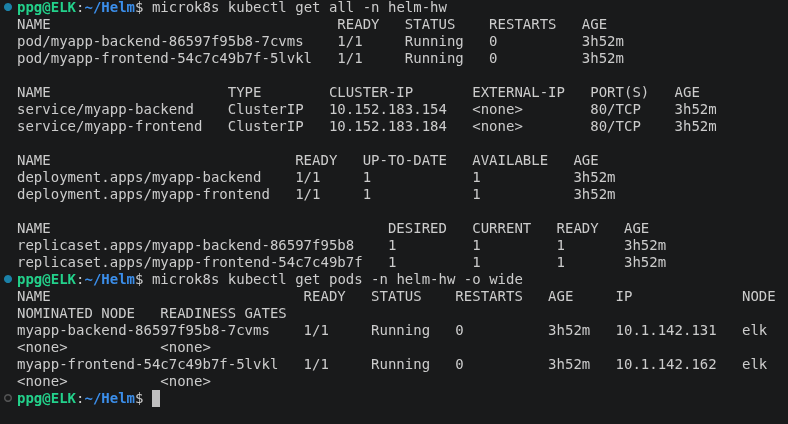

Ingress и Middleware

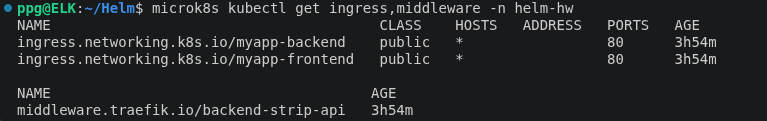

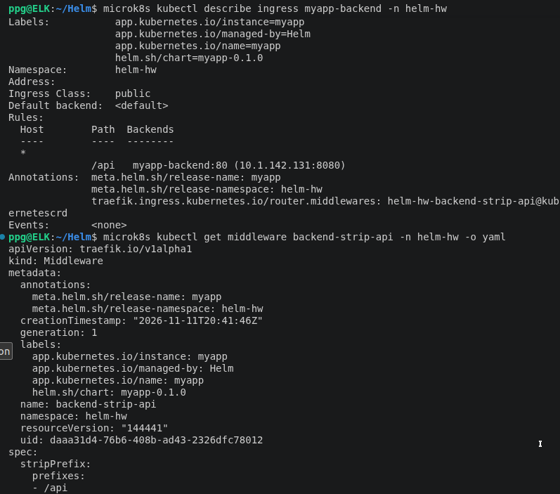

Проверка Frontend

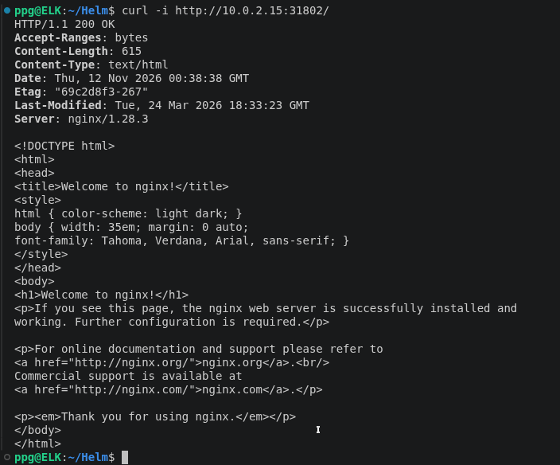

Проверка Backend

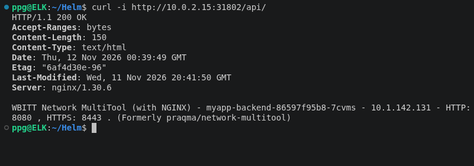

Вычисленные значения Helm

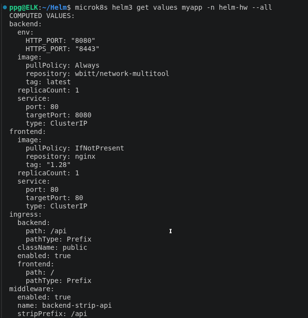

Упаковка чарта

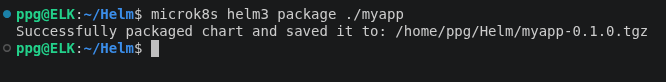

Проверка архива

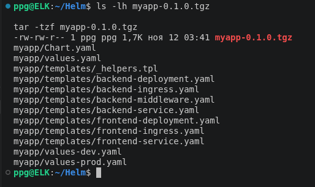

### Задание 2. Запустить две версии в разных неймспейсах

1. Подготовив чарт, необходимо его проверить. Запуститe несколько копий приложения.
2. Одну версию в namespace=app1, вторую версию в том же неймспейсе, третью версию в namespace=app2.
3. Продемонстрируйте результат.

### Решение 2.

Проверка Helm-чарта командой lint и генерация Kubernetes-манифестов для первого релиза.

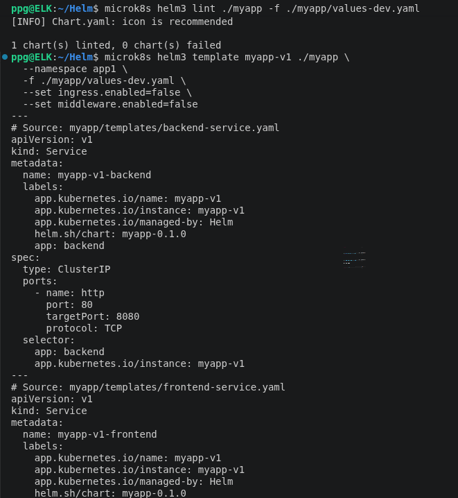

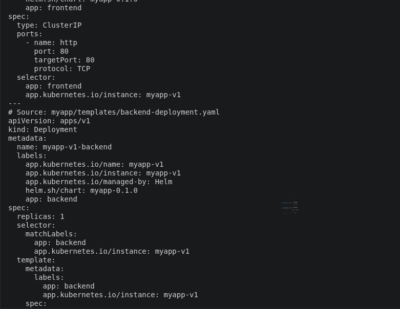

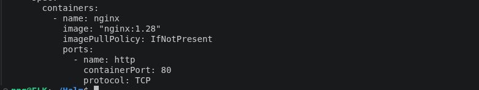

Проверка пространств имён app1 и app2 для размещения экземпляров приложения.

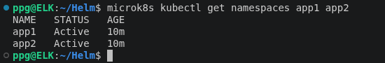

Два независимых экземпляра приложения myapp-v1 и myapp-v2 в namespace app1. Для каждого экземпляра созданы отдельные frontend и backend Pod и Service

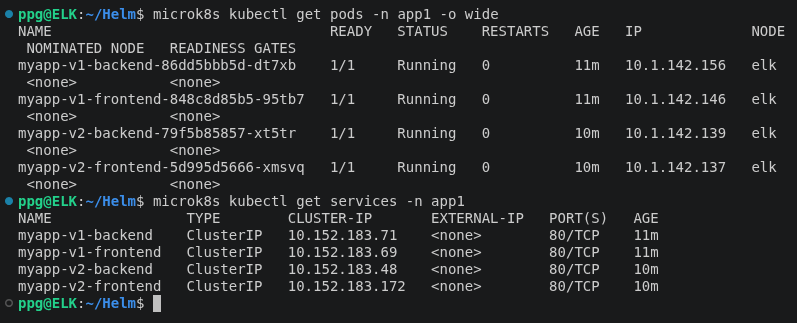

Проверка изоляции Service в namespace app1. Каждый Service связан только с Pod своего Helm-релиза благодаря уникальной метке app.kubernetes.io/instance.

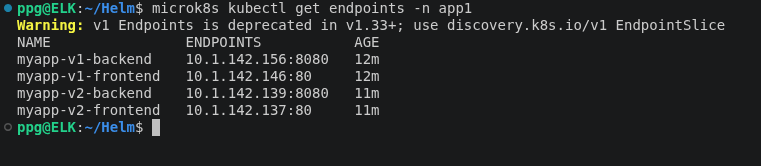

Развертывание третьего экземпляра приложения myapp-v3 в namespace app2. Frontend и backend работают независимо от экземпляров, размещённых в app1.

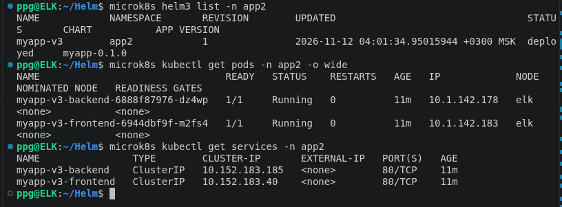

Проверка Endpoint в namespace app2. Сервисы третьего экземпляра приложения направляют трафик к соответствующим backend и frontend Pod.

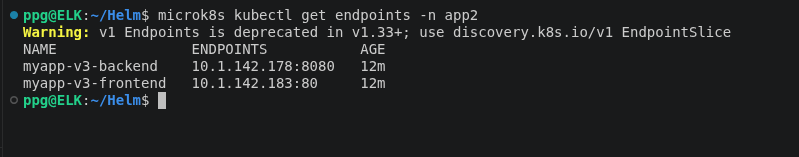

Список Helm-релизов во всех пространствах имен. Подтверждено успешное развёртывание трех экземпляров приложения: двух в app1 и одного в app2.

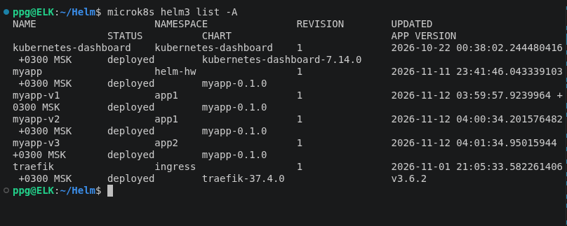

Проверка состояния Deployment в пространствах имен app1 и app2. Все шесть Deployment имеют READY 1/1 и AVAILABLE 1.

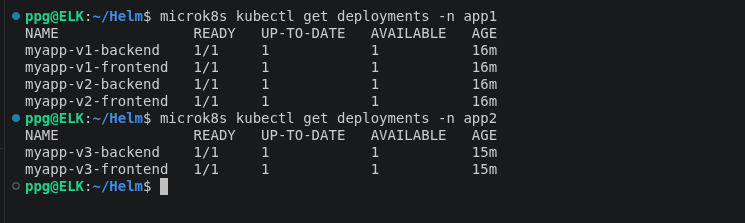

